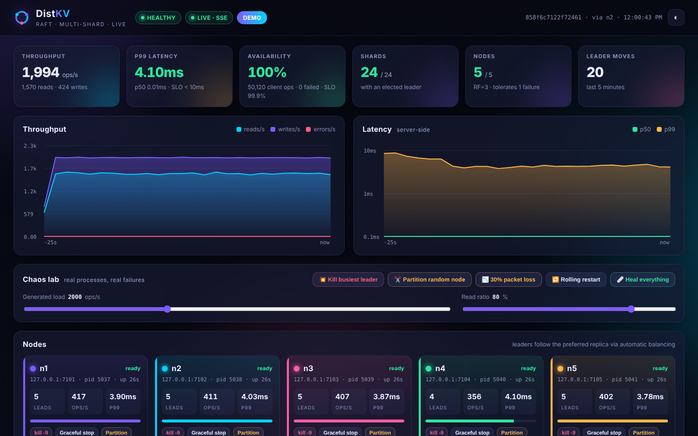
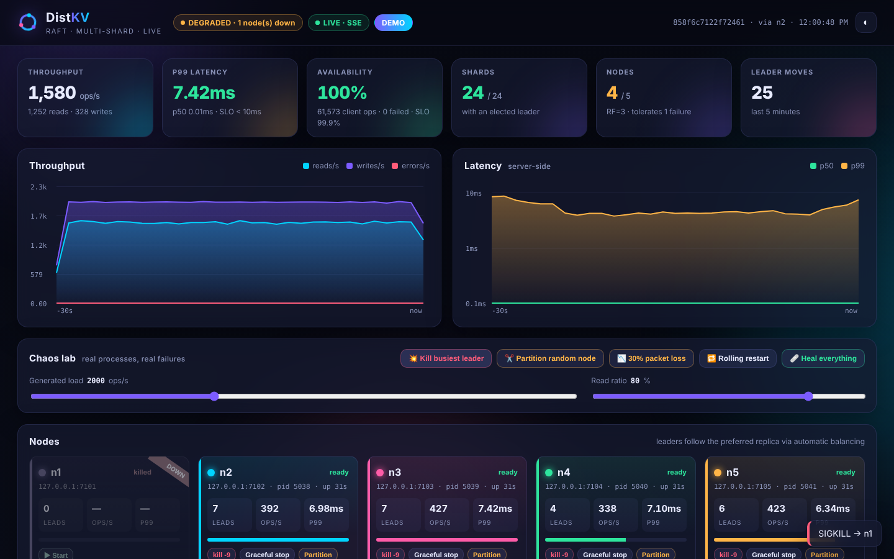
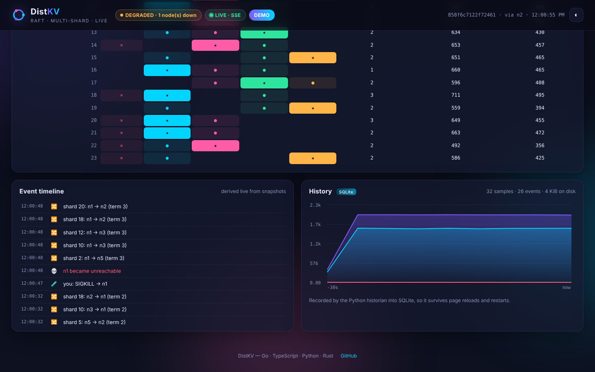
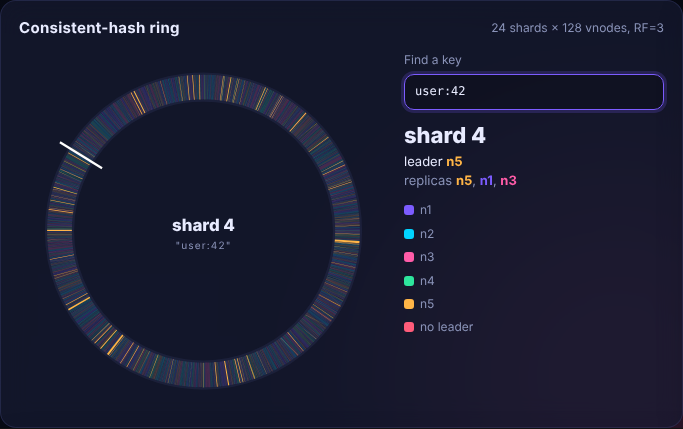
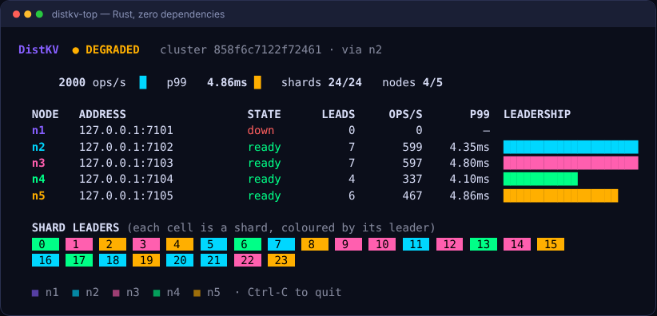
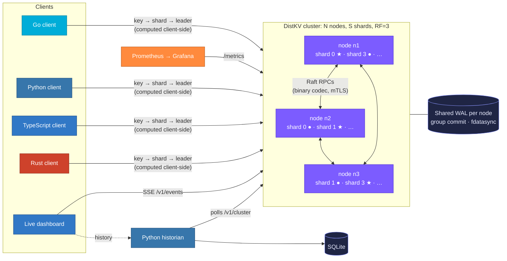

<p align="center">
  
</p>

<p align="center">
  <a href="https://github.com/UDogg/DistKV/actions/workflows/ci.yml"></a>
  <a href="https://github.com/UDogg/DistKV/actions/workflows/polyglot.yml"></a>
  
  
</p>
<p align="center">
  
  
  
  
  
  
</p>

<p align="center"><b>Consensus, storage engine, wire protocol, sharding, metrics, dashboard and clients, all written from scratch.</b><br>
Every key lives in one of many Raft groups spread across the cluster. Kill any node and the cluster keeps serving.</p>

<table align="center">
<tr>
<td align="center" width="33%">🌐<br><b>See it in your browser</b><br><sub>Simulation mode on GitHub Pages: nothing to install</sub><br><br><a href="https://udogg.github.io/DistKV/"></a></td>
<td align="center" width="33%">☁️<br><b>Run the real thing in the cloud</b><br><sub>Free Codespaces quota, then <code>make demo</code></sub><br><br><a href="https://codespaces.new/UDogg/DistKV"></a></td>
<td align="center" width="33%">🐳<br><b>Run it locally</b><br><sub>one container, or <code>make demo</code> with Go 1.23+</sub><br><br><code>make docker-demo</code><br><sub>→ http://localhost:8080</sub></td>
</tr>
</table>

<p align="center">📘 <b>New here?</b> Follow the step-by-step <a href="https://udogg.github.io/DistKV/run.html"><b>Run guide</b></a> (<a href="docs/run.html">source</a>): one <code>docker run</code>, the full Compose stack, chaos commands and troubleshooting, all verified against a live cluster.</p>

---

<p align="center"></p>
<p align="center"><sub>The live dashboard driving five real <code>distkv</code> processes. Every number is measured, nothing is mocked.</sub></p>

## ✨ Highlights

<table>
<tr>
<td width="50%" valign="top">

### 🗳️ Raft, built from scratch
Leader election with **pre-vote** and **check-quorum**, log replication with fast back-tracking,
snapshots and `InstallSnapshot`, **leadership transfer**, and two linearizable read paths
(**leader leases** and **ReadIndex**). Every optimisation comes with a written safety argument in [docs/RAFT.md](docs/RAFT.md).

</td>
<td width="50%" valign="top">

### 🧩 Sharded multi-Raft
Keys go to shards on a **consistent-hash ring** with virtual nodes, and shards go to nodes by
**rendezvous hashing**. Each shard is its own Raft group, with leadership **balanced** across the
cluster and handed off gracefully on shutdown.

</td>
</tr>
<tr>
<td valign="top">

### 💾 A real storage engine
A shared per-node **write-ahead log** with **group commit** across all shards, preallocated
segments, `fdatasync`, CRC-checked records, torn-write recovery and segment GC.

</td>
<td valign="top">

### 🧪 Correctness you can check
A Porcupine-style **linearizability checker** verifies ~190k-operation histories recorded while
nodes crash. The Raft harness injects partitions, message loss and crashes that lose unsynced
writes, and the wire codec is fuzzed.

</td>
</tr>
<tr>
<td valign="top">

### 📊 Live dashboard and chaos lab
A TypeScript dashboard embedded in every binary: live charts over SSE, a hash-ring visualisation,
a shard matrix, an incident timeline, and buttons for `kill -9`, **network partitions** and **packet loss**.

</td>
<td valign="top">

### 🌍 Polyglot, with proven routing
Go servers, plus **Python**, **TypeScript** and **Rust** SDKs, a **SQLite**-backed Python
historian, and `distkv-top`, a Rust terminal monitor. All four languages pass the same
[golden routing vectors](testdata/routing/vectors.tsv).

</td>
</tr>
</table>

## 📈 Results

Measured on **one 4-vCPU VM** running all three servers *and* the load generator, with **fsync on every
commit**. That's a deliberately unfavourable setup. Methodology and raw output are in [docs/BENCHMARKS.md](docs/BENCHMARKS.md).

| Scenario | Ops | Failed | Availability | p50 | p99 |
|---|---:|---:|---:|---:|---:|
| 🟢 Steady state, **10,000 ops/s**, 80/20 read/write, 60 s | 600,000 | **0** | **100%** | **0.55 ms** | **8.96 ms** |
| 💥 Same load, a random node **SIGKILLed every ~12 s** | 600,000 | **0** | **100%** | 0.58 ms | 541 ms ¹ |
| 🔁 Rolling restart of every node (graceful hand-off) | 10,000 | **0** | **100%** | 0.76 ms | 2.8 ms |
| 🔐 10,000 ops/s over **mutual TLS 1.3** | 300,000 | **0** | **100%** | 0.60 ms | 9.5 ms |

<sub>¹ Requests to shards whose leader was killed wait out an election (~0.5–1 s at the default 500 ms timeout) and are
retried, never lost. Write-only p99 at 10k ops/s is 13.6 ms on this shared box. See the benchmark doc.</sub>

## 🎬 Failover, live

<table>
<tr>
<td width="60%"></td>
<td width="40%" valign="top">

**1.3 seconds after `kill -9` of the busiest leader:**

- 🟡 the cluster reports **DEGRADED · 1 node down**
- 🗳️ all **24/24 shards** already have new leaders
- ✅ client availability stays at **100%**, with 0 failed operations
- 📉 throughput dips for about a second, then recovers

Writes that were in flight are retried with the same session sequence number, so each is applied **exactly once**.

</td>
</tr>
<tr>
<td></td>
<td valign="top">

**The incident timeline** is derived live from SSE snapshots: your `SIGKILL`, the node going
unreachable, then each shard's leader moving within the same second.

**The history panel** comes from the Python historian, which records every second into
**SQLite**, so the timeline survives page reloads and restarts.

</td>
</tr>
</table>

<table>
<tr>
<td width="45%"></td>
<td width="55%"></td>
</tr>
<tr>
<td align="center"><sub><b>The real hash ring</b>: 3,072 virtual nodes coloured by shard leader. Type a key and the
browser hashes it with the same FNV-1a + SplitMix64 code as the servers.</sub></td>
<td align="center"><sub><b><code>distkv-top</code></b>: an htop for the cluster in standard-library-only Rust (its own JSON
parser and HTTP client).</sub></td>
</tr>
</table>

## 🏗️ Architecture



<details>
<summary><b>🔍 What happens on a write?</b> (click to expand)</summary>

```mermaid
sequenceDiagram
    autonumber
    participant C as Client
    participant L as Shard leader
    participant F1 as Follower
    participant F2 as Follower
    C->>C: shard = ring(hash(key)); leader from cache
    C->>L: PUT /v1/kv/key  (session id + seq)
    L->>L: append to log, buffer to WAL
    par replicate
        L->>F1: AppendEntries (batched)
        F1->>F1: WAL append + group-commit fdatasync
        F1-->>L: ack
    and leader durability
        L->>L: group-commit fdatasync
    end
    L->>L: quorum reached → commit → apply to kv.Store
    L-->>C: 200 {"version": N}
```

Reads under a **leader lease** skip the network entirely. A quorum acknowledged a heartbeat
within 0.9 × the election timeout, and followers refuse to vote for anyone else for a full
timeout, so no other leader can exist. The safety argument, and the test that checks it, are in [docs/RAFT.md](docs/RAFT.md#leader-leases-641-the-default).
</details>

## 🌍 Polyglot components

| | Component | Language | Where | Tested by |
|---|---|---|---|---|
| 🧠 | Raft, log engine, servers, demo supervisor | **Go** | `internal/`, `cmd/` | unit, fault-injection, chaos and linearizability tests, fuzzing |
| 📊 | Live dashboard (bundled into the Go binary) | **TypeScript** | `web/dashboard` | `tsc --strict`, screenshot checks |
| 📦 | Client SDK | **TypeScript** | `clients/typescript` | `node:test` against the golden vectors and a live cluster |
| 🐍 | Client SDK + historian (SQLite) | **Python** | `clients/python` | `unittest` against the golden vectors, a fake cluster and a live cluster |
| 🦀 | Client SDK + `distkv-top` | **Rust** | `clients/rust` | `cargo test` against the golden vectors and a live cluster, clippy `-D warnings` |

**Cross-language routing guarantee:** `go test ./internal/cluster -run TestRoutingVectors` generates
[`testdata/routing/vectors.tsv`](testdata/routing/vectors.tsv) (hashes, key → shard, shard → replicas), and every
SDK's test suite must reproduce it bit for bit. A client in any language therefore sends each key straight to the right leader.

## 🚀 Quick start

<details open>
<summary><b>One container</b> (5 nodes, traffic, dashboard: Docker only)</summary>

```bash
docker build -t distkv:local .
docker run --rm -d --name distkv-demo -p 8080:8080 --entrypoint distkv-demo distkv:local \
  --listen 0.0.0.0:8080 --dir /data/demo --historian=false
# open http://localhost:8080 · stop with: docker stop distkv-demo   (or simply: make docker-demo)
```
</details>

<details open>
<summary><b>The full demo</b> (5 nodes, traffic, dashboard, historian)</summary>

```bash
make demo                      # builds, then runs bin/distkv-demo --fresh
# open http://localhost:8080 and press the chaos buttons
make top                       # in another terminal: the Rust terminal monitor
```
`distkv-demo` supervises **real processes**. *Kill -9* sends `SIGKILL`. *Partition* cuts a node
off from its peers using built-in fault injection, while clients can still reach it. *Packet loss*
drops 30% of its Raft messages.
</details>

<details>
<summary><b>CLI, curl and every SDK</b></summary>

```bash
make cluster                                     # 3 nodes, 16 shards (scripts/cluster.sh)
bin/distkvctl put user:42 alice --ttl 10m        # prints OK version=N
bin/distkvctl get user:42
bin/distkvctl cas user:42 N bob                  # compare-and-set
bin/distkvctl cluster                            # leaders, terms, health
curl -X PUT 'localhost:7002/v1/kv/greeting?ttl=30s' --data hello   # any node works
```

```go
c, _ := client.New(ctx, client.Config{Endpoints: []string{"http://127.0.0.1:7001"}})
ver, _ := c.Put(ctx, "user:42", []byte("alice"), client.WithTTL(time.Minute))
item, _ := c.Get(ctx, "user:42")                       // linearizable
_, err := c.CompareAndSwap(ctx, "user:42", item.Version, []byte("bob"))
```

```python
from distkv import Client                     # stdlib only
c = Client("http://127.0.0.1:7001")
c.put("user:42", "alice", ttl=60)
print(c.get("user:42").text, c.shard_for_key("user:42"))
```

```ts
import { Client } from "@distkv/client";      // zero runtime deps
const c = await Client.connect({ endpoints: ["http://127.0.0.1:7001"] });
await c.put("user:42", "alice", { ttlMs: 60_000 });
console.log((await c.get("user:42")).text());
```

```rust
let c = distkv::Client::connect(&["http://127.0.0.1:7001"])?;   // std only
c.put("user:42", b"alice", None)?;
let item = c.get("user:42")?.expect("present");
```
</details>

<details>
<summary><b>Docker Compose</b> (5 nodes, load generator, historian, Prometheus, Grafana)</summary>

```bash
make compose-up
# dashboard  http://localhost:7001/ui/?historian=http://localhost:8090
# grafana    http://localhost:3000
docker compose -f deploy/docker-compose.yml kill distkv3        # chaos
curl -X POST localhost:7002/v1/admin/faults -d '{"isolated":true}'   # partition n2
bin/distkvctl --endpoints http://localhost:7001 --no-smart get greeting   # host clients: --no-smart
```
Clients on the host must disable smart routing (`--no-smart`, `smart=False`, `DisableSmartRouting`), because the
cluster advertises container hostnames. The [run guide](docs/run.html) explains why.
</details>

<details>
<summary><b>Kubernetes, TLS and benchmarks</b></summary>

```bash
kubectl apply -f deploy/kubernetes/distkv.yaml   # StatefulSet + PDB + probes
TLS=1 scripts/cluster.sh start 3 16              # mutual TLS with a throwaway CA
scripts/bench.sh 10000 60s                       # the headline benchmark
scripts/chaos-bench.sh 10000 60                  # SIGKILL a node every ~12 s under load
make chaos                                       # in-process linearizability + availability tests
```
</details>

## 🧪 Testing

```bash
make race        # all Go tests under the race detector, chaos tests included
make polyglot    # Python + TypeScript + Rust SDKs and the dashboard type-check
make fuzz        # fuzz the Raft wire codec
```

| Layer | What's verified |
|---|---|
| **Raft** | elections, no disruption by rejoining nodes (pre-vote), check-quorum, back-tracking after minority partitions, crashes that lose unsynced writes, snapshot install, ReadIndex batching, **a lease always expires before a new leader exists**, leadership transfer, randomized churn with 10% message loss checked for divergent applies |
| **Storage** | WAL round trips, torn and corrupt tails, snapshot checksums, segment rotation and GC with idle groups, group commit |
| **State machine** | determinism across replicas and snapshots, TTL, LRU, CAS, exactly-once sessions |
| **End to end** | CRUD and CAS counters, forwarding through any node, failover, graceful hand-off, restarts from disk, mTLS, partitions via fault injection, **linearizability under chaos** (the checker is shown to catch stale reads), **availability under chaos** |
| **Polyglot** | golden routing vectors in 4 languages, every SDK against a live 5-node cluster in CI |

## 🎁 Free extras

| | |
|---|---|
| 🌐 **GitHub Pages** | the dashboard in simulation mode, deployed by [`pages.yml`](.github/workflows/pages.yml) |
| ☁️ **Codespaces** | [`devcontainer.json`](.devcontainer/devcontainer.json) with Go, Node, Python and Rust; port 8080 opens itself |
| 📦 **Releases** | tag `v*` to get binaries for 5 platforms, `distkv-top`, checksums, and multi-arch images on GHCR |
| 🛡️ **Security** | CodeQL (Go, TS, Python), Dependabot for 7 ecosystems, `SECURITY.md`, mTLS |
| 📈 **Observability** | Prometheus metrics, a Grafana dashboard, SLO burn-rate alerts, `/v1/events` SSE stream |
| 🧰 **DX** | `make help`, issue forms, a PR checklist, `.editorconfig`, `CITATION.cff` |

## 📚 Documentation

| | |
|---|---|
| [Run guide](docs/run.html) | Docker, Compose and local setup, chaos commands, troubleshooting (HTML, [hosted](https://udogg.github.io/DistKV/run.html)) |
| [Architecture](docs/ARCHITECTURE.md) | components, sharding, the log engine, request routing |
| [Raft notes](docs/RAFT.md) | safety arguments for pre-vote, leases, durability and group commit |
| [HTTP API](docs/API.md) | endpoints, headers, error codes, SSE, fault injection |
| [Operations](docs/OPERATIONS.md) | configuration, deployment, monitoring, TLS, failure handling |
| [Benchmarks](docs/BENCHMARKS.md) | methodology, raw results, optimisation history |
| SDK guides | [Python](clients/python/README.md) · [TypeScript](clients/typescript/README.md) · [Rust](clients/rust/README.md) · [Dashboard](web/dashboard/README.md) |

<p align="center"><sub>Apache 2.0 · Built with Go, TypeScript, Python and Rust · ★ = leader, ● = follower</sub></p>
